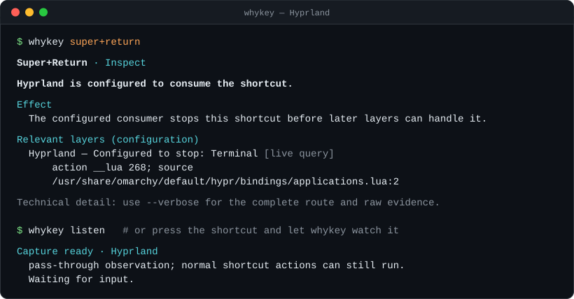
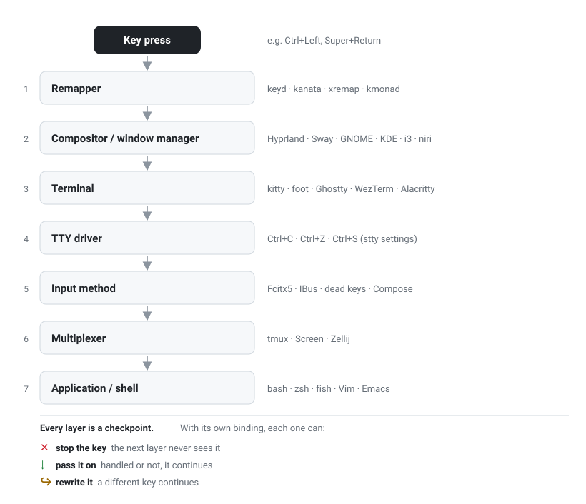
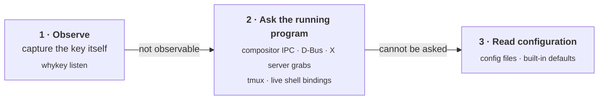
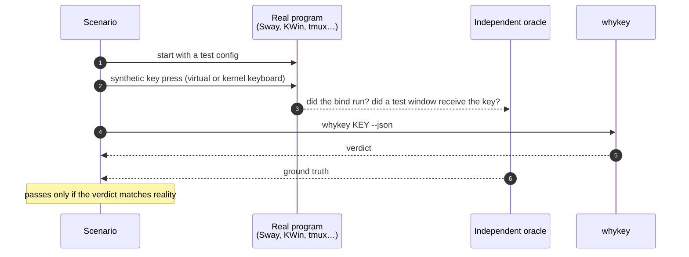

<!-- Generated from README.md by tools/generate_crates_readme.py. Do not edit it by hand; CI checks that it is current. -->

<h1 align="center">whykey</h1>

<p align="center">
  <b>Why didn't my shortcut work?</b><br>
  whykey traces a key press through every layer of the Linux input stack<br>
  and tells you which program took it, and why.
</p>

<p align="center">
  <a href="https://github.com/agustinrojas1/whykey/actions/workflows/ci.yml"></a>
  <a href="https://github.com/agustinrojas1/whykey/releases/latest"></a>
  
  
  <a href="LICENSE"></a>
</p>

<p align="center">
  <a href="#install">Install</a> ·
  <a href="#quick-start">Quick start</a> ·
  <a href="#how-it-works">How it works</a> ·
  <a href="#supported-environments">Supported environments</a> ·
  <a href="#verified-against-reality">Verified against reality</a> ·
  <a href="#documentation">Docs</a>
</p>

<p align="center">
  
</p>

---

## The problem

On Linux, a key press does not go straight to the application. It passes
through a chain of programs, and **any one of them can take the key and stop
it there**:

<p align="center">
  
</p>

When `Ctrl+Left` does nothing in your editor, the culprit could be a global
desktop shortcut, a terminal keybinding, a tmux prefix, or a line-editor
binding in your shell. Finding out means reading half a dozen config formats
and guessing which one is actually loaded.

**whykey does that for you.** Give it a key combination, or just press it,
and it walks the chain: it says which layer handles the key, whether the key
continues to the next one, and how sure it is.

## Highlights

- **One command, the whole route.** Remappers, 20 compositors, desktops, and
  window managers, desktop shortcut daemons, terminals, input methods, the TTY,
  multiplexers, shells, and editors in a single report.
- **Asks the running programs, not just their files.** Answers come from
  compositor IPC, D-Bus, the X server, tmux, and your shell's live bindings
  whenever possible, so they reflect what is actually loaded.
- **Watches the real key.** `whykey listen` captures the shortcut as you
  press it, through the compositor, a probe window, the terminal, or the
  kernel.
- **Honest about certainty.** Every answer carries its evidence: *observed*,
  *live query*, *config file*, or *default*. When whykey cannot know, it says
  so instead of guessing.
- **Safe by design.** Read-only: it never edits configuration and never runs
  the shortcut it inspects. Temporary capture state is always restored.
- **Verified against real programs.** A lab of 249 scenarios runs real
  compositors, desktops, terminals, and shells, presses real keys, and checks
  that whykey's verdict matches what actually happened.
- **Scriptable.** Stable JSON (schema v1 and v2) and NDJSON output, shell
  completions, snapshots, and diffs.

## Install

whykey runs on Linux (x86_64 and aarch64). Pick one:

**mise** (prebuilt binary)

```sh
mise use github:agustinrojas1/whykey@2
```

**Homebrew** (prebuilt static binary, Linux only)

```sh
brew install agustinrojas1/tap/whykey
```

**Fedora, openSUSE, Debian, Ubuntu** (openSUSE Build Service, x86_64 and aarch64)

Packages for Fedora 43, 44 and Rawhide, openSUSE Tumbleweed and Leap 16.0,
Debian 13, and Ubuntu 26.04 and 26.10. The
[download page](https://software.opensuse.org/download.html?project=home%3Aagustinrojas&package=whykey)
has the steps for each. On Fedora:

```sh
sudo dnf config-manager addrepo --from-repofile=https://download.opensuse.org/repositories/home:agustinrojas/Fedora_$(rpm -E %fedora)/home:agustinrojas.repo
sudo dnf install whykey
```

**Cargo** from [crates.io](https://crates.io/crates/whykey) (Rust 1.85 or newer)

```sh
cargo install whykey --locked
```

**Release binaries.** Each [release](https://github.com/agustinrojas1/whykey/releases/latest)
publishes archives with a `.sha256` checksum:

| Asset | Runs on |
| --- | --- |
| `whykey-<version>-x86_64-unknown-linux-gnu.tar.gz` | x86_64 with glibc 2.28+ (Debian 10, Ubuntu 18.10, RHEL 8 and later) |
| `whykey-<version>-x86_64-unknown-linux-musl.tar.gz` | any x86_64 Linux: fully static (Alpine, older glibc) |
| `whykey-<version>-aarch64-unknown-linux-musl.tar.gz` | any aarch64 Linux: fully static |

**Distribution packages.** Arch, Debian, RPM, and Nix recipes live in
[`packaging/`](packaging/README.md).

<details>
<summary>Notes on mise version pinning and the editor extensions</summary>

By default mise hides releases younger than 24 hours
(`minimum_release_age`). During a release's first day, `@2` can fail; an
exact version such as `@2.4.1` installs at once.

The editor extensions (`whykey-nvim`, `whykey-vscode`, `whykey-emacs`) are
`python3` scripts. Distribution packages install them next to `whykey`; mise
and `cargo install` do not put them on `PATH`. With mise they are in
`"$(mise where github:agustinrojas1/whykey)/extensions"`; with Cargo, take
them from the repository's `extensions/` directory.

</details>

## Quick start

```sh
whykey ctrl+left            # who handles Ctrl+Left, and does it get through?
whykey listen               # press a shortcut and let whykey watch it
whykey doctor               # what whykey can observe and ask on this machine
```

| Command | Answers |
| --- | --- |
| `whykey KEY` | Which layer handles `KEY`, and whether it continues downstream. |
| `whykey inspect ctrl+x ctrl+e` | The same for a sequence; prefix state (tmux, Readline, Screen) carries over. |
| `whykey inspect --focused ctrl+z` | Inspect against the focused window's process. |
| `whykey listen` | Capture the next shortcut you press and explain its path. |
| `whykey doctor` | Which integrations are available here, and what to enable. |
| `whykey bindings --key ctrl+x` | Every binding for a key across the detected layers. |
| `whykey conflicts` | Shortcuts that fire together or shadow each other. |
| `whykey snapshot KEY` / `diff A B` | Save a diagnosis and compare it with a later one. |

Keys are written as modifiers and a key joined with `+`: `ctrl`, `alt`,
`shift`, `super`, `hyper`, `altgr`, `caps`, `num`, plus a character, a named
key (`return`, `left`, `f1`, `kp_enter`), an XF86 media key, or `code:N`.
`whykey --help` lists every command and option.

For the most accurate shell answers, load the shell integration once in your
shell's startup file:

```sh
eval "$(whykey shell-init bash)"      # or: zsh
whykey shell-init fish | source       # fish
```

## Reading a report

```text
Super+Return                                           Hyprland · Wayland · bash

✕ Hyprland takes Super+Return and runs Terminal.          ← verdict
  Nothing after Hyprland receives Super+Return.           ← consequence

Route                                                     ← the seven layers, in order
  1  Remapper      ↓  none detected
  2  Hyprland      ✕  Terminal                                     live query
  3  Terminal      ·  not reached                                  ↑ evidence tier
  ...
Bound in                                                  ← where the binding lives
  /usr/share/omarchy/default/hypr/bindings/applications.lua:2
  __lua 268 (Lua dispatcher; whykey does not execute it)

Confidence  live query: Hyprland answered from the running program...
More  whykey super+return -v                              ← every layer and raw evidence
```

The header names the environment that was evaluated (compositor, session,
shell). The first line is the verdict; the route shows every layer in the order
the key travels, so you can see where the chain was cut and which layers were
never reached.

| Glyph | ASCII | Color | Meaning |
| --- | --- | --- | --- |
| `✕` | `x` | red | The layer keeps the key; nothing after it receives it. |
| `↓` | `v` | green | The layer lets the key through, with or without an action of its own. |
| `↪` | `>` | yellow | The layer rewrites the key, or waits for another one. |
| `?` | `?` | yellow | whykey could not verify it: a default, an unloaded file, an opaque dispatcher. |
| `·` | `-` | dim | Not reached, or not applicable here. |

The right-hand column says how well the answer is known, with one of four
words: `observed` (whykey saw the key arrive), `live query` (the running
program was asked), `config file` (a file was read, not confirmed loaded) and
`default` (the program's built-in behavior; your configuration may override
it). Meaning never depends on color: `NO_COLOR`, `--color never` and
`TERM=dumb` give plain text, and `--ascii` (or a non-UTF-8 locale) swaps the
glyphs for the ASCII column. `whykey doctor` uses `✓ ✗ – ?` for available,
unavailable, not applicable here, and unknown.

## How it works

For every layer, whykey uses the strongest source of evidence available and
labels the answer with it:



| Tier | Meaning |
| --- | --- |
| `observed` | A capture saw the key pass this layer, or stop at it. |
| `live query` | The running program answered. |
| `config file (static)` | Parsed from configuration; the running program may differ. |
| `default (unverified)` | Built-in defaults; your configuration may override them. |

A report opens with a one-line **diagnosis**, its **effect**, the
**relevant layers** with their tiers, **what remains uncertain**, and a
**next step**. `--verbose` shows the full route and the raw evidence.

<details>
<summary>Capture backends used by <code>whykey listen</code></summary>

`listen` waits for one key and uses the first capture method that works:

| Order | Backend | What it proves |
| --- | --- | --- |
| 1 | **Native compositor capture**: Hyprland (Lua hook) or Sway (binding events over IPC) | The compositor received the key. Sway reports only keys that run a Sway binding. |
| 2 | **Probe window**: a small focused Wayland or X11 window | Whether the desktop delivered the key to a normal window. |
| 3 | **Terminal capture** | The key reached this terminal, and the bytes it arrived as. |

`--window`, `--terminal`, and `--evdev [--device PATH]` force one backend;
`--evdev` reads the kernel's view of the keyboard, before any remapper or
compositor. `whykey listen --dry-run` prints the chain without capturing.

On Hyprland, `--suppress` temporarily stops the shortcut from firing while
whykey inspects it. Capture state is held by a short lease, so Hyprland
drops it by itself even if whykey is killed.

</details>

<details>
<summary>Permissions</summary>

Everything except `listen --evdev` works without extra permission.
`--evdev` needs read access to `/dev/input/event*`; `whykey doctor` names
the keyboards it cannot open and prints a temporary grant for exactly those
devices:

```sh
sudo setfacl -m u:"$USER":r '/dev/input/eventN'   # gone after replug or reboot
```

</details>

## Supported environments

✅ verified against the real program in the lab · 🟡 verified in part (some
cases answer as honest uncertainty or are not covered) · ⚪ supported from
documentation and configuration only

| Layer | Programs |
| --- | --- |
| **Wayland compositors** | ✅ Hyprland · ✅ Sway · ✅ Wayfire · ✅ labwc · ✅ dwl · 🟡 Niri · ⚪ River |
| **Desktops** | ✅ GNOME (mutter, GNOME Shell, media keys) · ✅ KDE Plasma (KWin, kglobalaccel) · ✅ Cinnamon · ✅ Xfce · ✅ MATE |
| **X11 window managers and hotkey daemons** | ✅ i3 · ✅ Openbox · ✅ AwesomeWM · ✅ Qtile · ✅ XMonad · ✅ sxhkd · ✅ xbindkeys · ⚪ herbstluftwm |
| **Key remappers** | ✅ keyd · ✅ kanata · ✅ xremap · 🟡 kmonad · 🟡 input-remapper |
| **Input methods** | ✅ Fcitx5 · 🟡 IBus |
| **Terminals** | ✅ kitty · ✅ Alacritty · ✅ foot · ✅ WezTerm · ✅ Konsole · ✅ Ghostty |
| **Multiplexers** | ✅ tmux · ✅ GNU Screen · ✅ Zellij |
| **Shells** | ✅ bash · ✅ zsh · ✅ fish (exact with `shell-init`) |
| **Editors** | ✅ Neovim · 🟡 Emacs · 🟡 Vim · 🟡 Helix · 🟡 Kakoune · 🟡 Micro · ⚪ VS Code · ⚪ JetBrains |

On X11, whykey also asks the X server directly whether any client holds a
grab on the key, so it catches window managers and daemons it has no adapter
for. The per-capability evidence is in the [support matrix](SUPPORT_MATRIX.md),
and the known boundaries are in the [defect register](DEFECT_REGISTER.md).

## Verified against reality

Unit tests only show that whykey agrees with its own authors. So every
support claim above comes from the **reality lab**: each scenario starts the
real program in a throwaway container or VM, presses a real key, and records
what actually happened through an independent path. whykey's verdict must
match.



Every scenario also needs a positive control, so a broken setup can never
pass by accident. Current run: **249 scenarios: 208 match exactly, 41 pass
as honest uncertainty, 0 fail.** Hyprland and KWin run in KVM guests, many
scenarios with a kernel-level keyboard, so keys travel the same evdev →
libinput → compositor path as a physical keyboard.

The lab has found and fixed dozens of bugs that passed every unit test. The
scenario format and how to run it are in [`lab/README.md`](lab/README.md).

## Design principles

- **Never act on the system.** Inspection is read-only; whykey does not edit
  configuration, start daemons, or execute shortcuts.
- **Prefer evidence over inference.** Ask the running program before reading
  its files, and label every answer with where it came from.
- **Say "I don't know".** Uncertain answers are reported as uncertain, and
  the lab counts them separately; they never count as verification.
- **Small and portable.** A single Rust binary, with fully static builds
  for x86_64 and aarch64; Linux only, by design.

## Documentation

| Document | Contents |
| --- | --- |
| [SPEC.md](SPEC.md) and [whykey.1](whykey.1) | Full behaviour specification and man page |
| [ADAPTER_INVENTORY.md](ADAPTER_INVENTORY.md) | Sources and limits of each adapter |
| [SUPPORT_MATRIX.md](SUPPORT_MATRIX.md) | Capabilities and the lab scenarios behind each one |
| [DEFECT_REGISTER.md](DEFECT_REGISTER.md) | Fixed defects with their regression tests, and accepted limitations |
| [lab/README.md](lab/README.md) | The reality lab: scenario format, environments, running it |
| [docs/](docs/) | Capture backends, compositor extensions, platform scope |
| [CHANGELOG.md](CHANGELOG.md) | Release history |

## Development

```sh
cargo test --all-targets --locked
cargo clippy --all-targets --locked -- -D warnings
cargo fmt --all -- --check
python3 tools/generate_support_matrix.py --check
```

CI also runs the extension tests, provenance and packaging checks, and the
reality lab on every pull request. See [`lab/README.md`](lab/README.md) to
run the lab locally (Docker, and `/dev/kvm` for the VM scenarios).

<details>
<summary>Live Hyprland tests</summary>

Live tests change the compositor's state, so they never run in the normal
suite. Run them only in a dedicated session:

```sh
WHYKEY_RUN_LIVE_TESTS=1 WHYKEY_LIVE_INSTANCE_SIGNATURE="$HYPRLAND_INSTANCE_SIGNATURE" \
cargo test --test hyprland_live -- --ignored
```

</details>

## License

[MIT](LICENSE)
